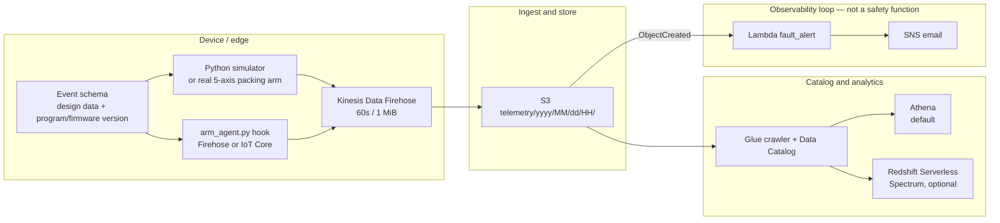

# Digital Thread AWS Lab

An open-source teaching module for a **Digital Thread** class. Students
follow a packed item from a shared event schema (design data and robot
program / firmware version), through a **5-axis packing robot**
(simulated, then optionally real), into AWS, and out to queries and
fault alerts.

The physical cell is a desktop 5-axis robot arm that picks items from an
infeed conveyor or tray, scans them, and places them into two or three
packing boxes / cartons by order. A Python simulator stands in for the
arm until you plug in the real one. The cloud pipeline stays the same
either way, because both producers honor `shared/event.schema.json`.



Each IAM role in `iam/` can do only what its service needs, on one
bucket prefix, one stream, or one topic.

## What’s in this repository

| Path | Purpose |
|---|---|
| `shared/` | Event JSON Schema — the start of the thread |
| `simulator/` | 5-axis packing-arm state machine → Firehose (or `--dry-run`) |
| `agent/` | Hook to replace the simulator with a real arm |
| `lambda/fault_alert.py` | S3 → scan for `FAULT` / `ESTOP` / `GRIP_FAIL` bursts → SNS |
| `iam/` | Least-privilege trust + permission policies |
| `infra/setup.sh`, `infra/teardown.sh` | Create and delete the AWS stack |
| `sql/queries.sql` | Spectrum external schema + analytics queries, Athena too |
| `docs/student-lab-guide.md` | Five ~2-hour labs, checkpoints, exercises |
| `docs/instructor-notes.md` | Schedule, cost, grading, gotchas |

## Prerequisites

- Python 3.9 or later (3.12 matches the Lambda runtime)
- An AWS account you are allowed to create resources in, and AWS CLI v2
- A mailbox you can use to confirm SNS (and budget) subscriptions
- Optional: `gettext` (`envsubst`). The setup script falls back to Python
  if `envsubst` is missing
- Optional, Lab 5 only: a 5-axis packing arm with a **hardwired E-stop**
  and a **guarded workspace**

No AWS credentials are required to run the simulator in `--dry-run` or
to run the unit tests.

## Cost and safety

Read this before you run `setup.sh`.

**Cost**

- Create the budget alarm that `setup.sh` provisions (`MONTHLY_BUDGET_USD`,
  default **$5**, emails at 50 % forecasted and 80 / 100 % actual). If
  your account cannot create AWS Budgets, set a billing alarm in the
  console yourself.
- The default path (Firehose, S3, Glue, Athena, Lambda, SNS) costs
  pennies for a lab afternoon if you tear it down the same day.
- **Athena is the default query engine.** Redshift Serverless is off
  unless you set `ENABLE_REDSHIFT=1`. It is billed in RPU-seconds, has
  a per-query minimum, and is the easy way to blow a student budget.
  If you turn it on, delete the workgroup the same day. New accounts
  sometimes have Serverless trial credit — do not rely on it.
- **EMR is deliberately not used.** A cluster is slow to start and
  expensive for a 2-hour session. The Glue catalog on S3 is already a
  reasonable future landing zone for a Spark job if you need one later.
- When you are finished: `CONFIRM=yes ./infra/teardown.sh`.

**Safety**

- Cloud alerts are observational. A `FAULT` or `ESTOP` event that
  travels Firehose → S3 → Lambda → email is **not** a safety-rated
  emergency stop.
- A real packing arm must have a hardwired E-stop that cuts motor
  power with the network unplugged, and must run inside a guarded
  workspace (fixed enclosure, interlocked door, or light curtain)
  that is also hardwired. Never wire “the Lambda will stop the arm.”

## One-afternoon path (~2 hours on AWS)

The full course is five labs in `docs/student-lab-guide.md`. If you only
have one sitting, use this timeline.

| Time | What you do |
|---|---|
| 0:00–0:20 | Read `shared/schema.md`. Run `python simulator/simulate.py --dry-run --duration 20 --seed 1`. Confirm the budget / email settings in `infra/config.env`. |
| 0:20–0:50 | `./infra/setup.sh`. Confirm the SNS email. Attach the printed `dtlab-simulator` policy if you are not using an admin role. |
| 0:50–1:15 | `python simulator/simulate.py --stream-name dtlab-telemetry --region <your-region> --duration 180 --rate 8`. Wait 60 s, then `aws s3 ls` the `telemetry/` prefix. |
| 1:15–1:40 | Start the Glue crawler. In Athena, run queries 1–7 from `sql/queries.sql`, plus the program / firmware version comparison. |
| 1:40–2:00 | Re-run the simulator with higher `--grip-fail-probability` and `--fault-probability`, wait for the fault email, screenshot it, then `CONFIRM=yes ./infra/teardown.sh`. |

Setup itself is mostly IAM + Firehose + Lambda and usually finishes in
well under 20 minutes; the 60-second Firehose buffer and the crawler
runtime are the parts you cannot rush.

## Quick start (local, no AWS)

```bash
python3 -m venv .venv
source .venv/bin/activate        # Windows: .venv\Scripts\activate
python simulator/simulate.py --dry-run --duration 20 --seed 1
python agent/arm_agent.py --dry-run
pip install -r tests/requirements.txt
python -m unittest discover -s tests -v
```

## Quick start (AWS)

```bash
cp infra/config.env.example infra/config.env
# edit NOTIFY_EMAIL, AWS_REGION, and (optionally) PROJECT_NAME
./infra/setup.sh

pip install -r simulator/requirements.txt
python simulator/simulate.py \
  --stream-name dtlab-telemetry \
  --region us-east-1 \
  --duration 180

# wait ~60s for Firehose to flush
aws glue start-crawler --name dtlab-telemetry-crawler --region us-east-1

# After you are done — this deletes the lab resources:
CONFIRM=yes ./infra/teardown.sh
```

Placeholders in `iam/*.json` (`${ACCOUNT_ID}`, `${BUCKET}`, `${REGION}`,
and the rest) are filled in by `setup.sh` via `envsubst` (or a Python
fallback).

## Resume bullet

You can adapt this for a portfolio or a lab write-up:

> Built a digital-thread telemetry pipeline for a simulated 5-axis
> pick-and-place packing arm (Kinesis Data Firehose → S3 → Glue → Athena
> / Redshift Spectrum, Lambda / SNS alerting on faults, E-stops, and
> grip-fail bursts, least-privilege IAM per service) to track picks per
> minute, cycle time per box, grip-fail rate, faults per axis, and
> E-stop recovery time; stamped every event with program and firmware
> version so a physical arm can replace the simulator without changing
> the cloud path.

## Ideas to extend

- Swap the simulator for the real arm with `agent/arm_agent.py` (Lab 5),
  including an AWS IoT Core topic rule that forwards MQTT into the same
  Firehose stream. Typical controllers: serial, ROS 2, OPC UA, Modbus.
- Hive-style prefixes (`year=YYYY/month=MM/…`) for cheaper Athena
  partition pruning.
- A small CloudWatch dashboard of places per minute, open E-stops, and
  peak joint temperature.
- Schema versioning (`schema_version` on every event) when you add
  fields mid-semester.
- Compare two packing programs (`--program-version`) in Athena and
  treat the result as an engineering change record.

## License

MIT. See `LICENSE`. Contributions are welcome — please read
`CONTRIBUTING.md` and `CODE_OF_CONDUCT.md` first.
